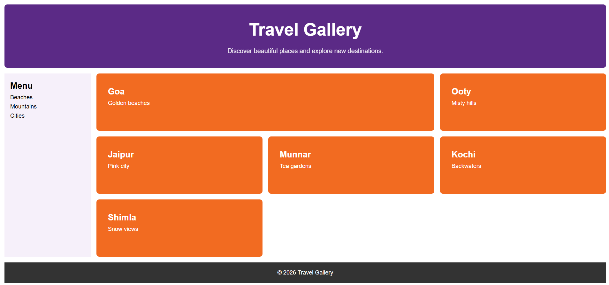

# Travel Gallery

A responsive travel photo gallery built with HTML and CSS Grid.

# Screenshot

## Features

- Responsive layout using CSS Grid
- Media queries for mobile, tablet and desktop
- Relative units (rem, %, vw) for flexible sizing
- Featured card that spans two columns

## Technologies Used

- HTML5
- CSS3 (Grid, Media Queries)
- Git and GitHub

## How to Run

1. Download or clone this repository.
2. Open `index.html` in any browser.
3. Resize the window to see the layout change.

## Author

**Sri Thulasika** – HackGeniX Intern, Batch 1